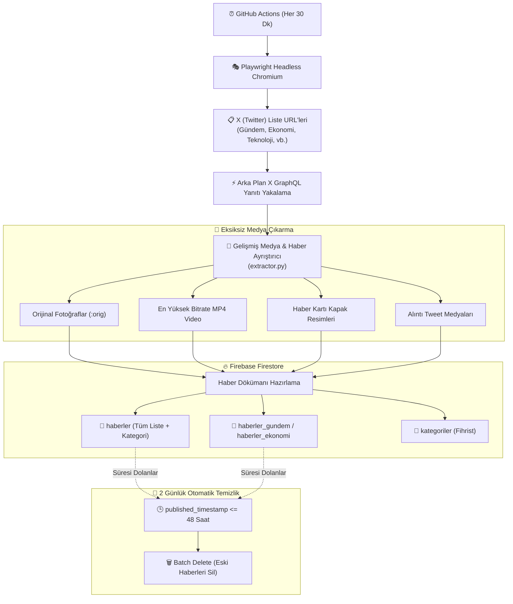

# 🚀 Novra AI - X (Twitter) Otomatik Haber & Medya Çekme Botu

<div align="center">


<p align="center">
  <b>X (Twitter) listelerindeki haber akışlarını, yüksek çözünürlüklü görselleri, en kaliteli MP4 videoları ve zengin metadata'ları toplayıp Firebase Firestore'a kategorize kaydeden, 2 günden eski verileri otomatik temizleyen yeni nesil haber otomasyonu.</b>
</p>

---

**Hazırlayanlar:** [Muhammed Yasin KORKUT](https://github.com/Yasin0234) & **Beyza KARAKAŞ**  
**Sürüm:** `1.4` | **Tarih:** `14 Ekim 2026`

</div>

---

## 🌟 Neden Bu Bot?

Haber siteleri ve mobil uygulamalar için X (Twitter) vazgeçilmez bir anlık bilgi kaynağıdır. Ancak X API ücretleri ve kısıtlamaları sebebiyle haberleri medya içerikleriyle birlikte düzenli çekmek zordur. 

**Novra AI Twitter Haber Botu**, arka planda çalışan görünmez tarayıcı (Playwright Chromium) teknolojisiyle resmi X listelerindeki API trafiğini yakalar. Alınan haberleri fotoğrafları, videoları, haber kartları ve yazar bilgileriyle birlikte **Firebase Firestore**'a aktarır ve veritabanınızın şişmemesi için **48 saat (2 gün)** sonra süresi dolan kayıtları otomatik temizler.

---

## ✨ v1.4 Yenilikleri ve Temel Özellikler

- 📸 **Eksiksiz Medya Yakalama:**
  - Tweet'e eklenmiş tüm fotoğraflar **en yüksek çözünürlükte** (`:orig` / `large`) toplanır.
  - Videolar ve animasyonlu GIF'lerin tüm varyantları taranarak **en yüksek bitrate'e sahip doğrudan `.mp4` video bağlantısı** yakalanır.
  - Video kapak görseli (`thumbnail_url`), video süresi (`duration`) ve en-boy oranı (`aspect_ratio`) kaydedilir.
  - Haber bağlantısı paylaşıldığında Twitter'ın oluşturduğu **Haber Kartı (Summary Large Image)** kapak görselleri ve başlıkları otomatik çekilir.
  - **Alıntı Tweetler (Quoted Tweets):** Başka bir kanaldan alıntılanan videolu ve resimli haberlerin medyaları da kayıpsız toplanır.

- 🗂️ **X Liste URL Desteği & Kategorizasyon:**
  - İster tek bir liste, ister onlarca farklı liste URL'si tanımlayın.
  - Haberler liste adına ve slug'ına göre (`gundem`, `ekonomi`, `teknoloji`, `spor` vb.) kategorize edilir.
  - Web sitenizde ve mobil uygulamanızda kategorilere göre filtreleme yapabilmeniz için hem tek koleksiyon (`where("category", "==", "ekonomi")`) hem de kategoriye özel koleksiyonlar (`haberler_ekonomi`) desteklenir.
  - Dinamik kategori menüleri için Firestore'da `kategoriler` fihristi otomatik güncellenir.

- ⏱️ **2 Günden Sonra Otomatik Temizleme (48 Saat Retention):**
  - Bot her çalıştığında 2 günden eski haberleri tespit eder ve Firestore `batch.delete()` ile veritabanından kalıcı olarak siler.
  - Dokümanlara eklenen `expires_at` alanı sayesinde Firestore'un dahili TTL (Time-To-Live) mekanizmasıyla da %100 uyumludur.

- ⚙️ **Dayanıklı & Tam Otomatik:**
  - GitHub Actions üzerinde 30 dakikada bir sıfır sunucu maliyetiyle çalışır.
  - İstenildiğinde GitHub Actions arayüzünden tek tıklamayla anlık çalıştırılabilir (`workflow_dispatch`).

---

## 🏗️ Mimari & Çalışma Akışı



---

## 📁 Proje Dosya Yapısı

```text
novraai-twitter-haber-cekme-botu/
├── .github/
│   └── workflows/
│       └── otomasyon.yml         # GitHub Actions 30 dk periyotlu iş akışı
├── bot.py                        # Ana orkestrasyon ve çalıştırma betiği
├── extractor.py                  # Medya (resim/video/kart), alıntı ve haber ayrıştırıcı
├── config.py                     # Liste URL yönetimi, çerezler ve konfigürasyon
├── database.py                   # Firebase Firestore kayıt ve 2 günlük otomatik temizlik
├── lists.example.json            # Çoklu liste yapılandırması için örnek JSON dosyası
├── requirements.txt              # Python kütüphane bağımlılıkları
└── README.md                     # Kapsamlı proje dokümantasyonu
```

---

## 🚀 Adım Adım Kurulum Rehberi

### 1. Adım: Firebase Servis Hesabı Anahtarını Alma
1. [Firebase Console](https://console.firebase.google.com/) sayfasına gidin ve projenizi seçin.
2. Sol üst kısımdaki **Proje Ayarları (Dişli çark) > Hizmet Hesapları (Service Accounts)** sekmesine geçin.
3. **Yeni Özel Anahtar Oluştur (Generate new private key)** butonuna basın.
4. İndirilen `.json` dosyasını açıp tüm içeriğini kopyalayın.

### 2. Adım: X (Twitter) Çerezlerini (Cookies) Alma
1. Tarayıcınıza (Chrome/Edge/Brave) **Cookie-Editor** eklentisini yükleyin.
2. [x.com](https://x.com) adresine girerek oturum açın.
3. Cookie-Editor simgesine tıklayın, sağ alttaki **Export > Export as JSON** seçeneğine basarak çerezleri panoya kopyalayın.

### 3. Adım: GitHub Secrets Tanımlama
Deponuzun **Settings > Secrets and variables > Actions** sayfasına gidin ve şu gizli anahtarları ekleyin:

| Secret Adı | Değer / Açıklama |
| :--- | :--- |
| `FIREBASE_CREDENTIALS` | 1. adımda kopyaladığınız Firebase servis hesabı JSON içeriği. |
| `TWITTER_COOKIES` | 2. adımda kopyaladığınız X çerez metni. |
| `TWITTER_LISTS` *(Opsiyonel)* | Takip etmek istediğiniz liste URL'leri (aşağıdaki örneklere bakınız). |

---

## 🌐 X Liste URL'leri Nasıl Eklenir?

İstediğiniz kadar X listesi ekleyebilirsiniz. `TWITTER_LISTS` değişkeni birden fazla formatı destekler:

### Seçenek A: Virgülle Ayrılmış Liste (Önerilen)
```env
https://x.com/i/lists/1975820683461460354|Gündem, https://x.com/i/lists/1234567890|Ekonomi, https://x.com/i/lists/9876543210|Teknoloji
```
*(Borubordur (`\|`) karakteri sonrasına kategori adını yazabilirsiniz, kategori slug'ı otomatik üretilir.)*

### Seçenek B: `lists.json` Dosyası Kullanımı
Deponuzun ana dizinine `lists.json` dosyası ekleyebilirsiniz:
```json
[
  {
    "url": "https://x.com/i/lists/1975820683461460354",
    "name": "Gündem ve Son Dakika",
    "category": "gundem"
  },
  {
    "url": "https://x.com/i/lists/1234567890123456789",
    "name": "Ekonomi ve Finans",
    "category": "ekonomi"
  }
]
```

> **Not:** Eğer hiçbir liste tanımlamazsanız, bot varsayılan genel haber listesini (`1975820683461460354`) kullanarak çalışır.

---

## ⚙️ Yapılandırma Seçenekleri (Ortam Değişkenleri)

| Değişken | Varsayılan | Açıklama |
| :--- | :--- | :--- |
| `RETENTION_DAYS` | `2` | Haberlerin Firestore'da tutulacağı gün sayısı. 2 günden eskiler otomatik silinir. |
| `SAVE_MODE` | `both` | `both`: Hem `haberler` hem `haberler_{kategori}` koleksiyonuna yazar.<br/>`single`: Yalnızca `haberler` koleksiyonuna yazar.<br/>`categorized`: Yalnızca kategori koleksiyonlarına yazar. |
| `MAIN_COLLECTION` | `haberler` | Ana koleksiyon adı. |
| `AUTO_CLEANUP_ENABLED` | `true` | Her çalıştırmada eski haberleri silme motorunu aktif/pasif yapar. |

---

## 📱 Web ve Mobil Uygulama Entegrasyonu

Kaydedilen veriler uygulamanızda veya web sitenizde doğrudan kullanılmaya hazırdır.

### Flutter (Dart) ile Kategoriye Göre Haber Çekme

```dart
// 'ekonomi' kategorisindeki son 20 haberi getir
FirebaseFirestore.instance
    .collection('haberler')
    .where('category', isEqualTo: 'ekonomi')
    .orderBy('published_timestamp', descending: true)
    .limit(20)
    .snapshots()
    .listen((snapshot) {
      for (var doc in snapshot.docs) {
        final haber = doc.data();
        print("${haber['author']['name']}: ${haber['clean_text']}");
        print("Görseller: ${haber['images']}");
        print("En Yüksek Kalite Video: ${haber['videos']}");
      }
    });
```

### React / Next.js / JavaScript ile Veri Çekme

```javascript
import { collection, query, where, orderBy, limit, getDocs } from "firebase/firestore";
import { db } from "./firebaseConfig";

async function getCategoryNews(categorySlug = "gundem") {
  const q = query(
    collection(db, "haberler"),
    where("category", "==", categorySlug),
    orderBy("published_timestamp", "desc"),
    limit(25)
  );

  const querySnapshot = await getDocs(q);
  return querySnapshot.docs.map(doc => ({ id: doc.id, ...doc.data() }));
}
```

---

## 📄 Firestore Veri Modeli Örneği

Her haber dokümanı şu zengin yapıyla kaydedilir:

```json
{
  "tweet_id": "1845123456789012345",
  "text": "Merkez Bankası faiz kararını açıkladı... https://t.co/xyz",
  "clean_text": "Merkez Bankası faiz kararını açıkladı...",
  "images": [
    "https://pbs.twimg.com/media/XYZ.jpg"
  ],
  "videos": [
    "https://video.twimg.com/amplify_video/.../vid/avc1/1080x1920/best.mp4"
  ],
  "has_media": true,
  "media_count": 2,
  "rich_media": [
    {
      "type": "video",
      "url": "https://video.twimg.com/.../best.mp4",
      "thumbnail_url": "https://pbs.twimg.com/media/XYZ.jpg",
      "duration_sec": 42.5,
      "bitrate": 2176000,
      "aspect_ratio": "16:9"
    }
  ],
  "category": "ekonomi",
  "category_name": "Ekonomi ve Finans",
  "list_name": "Ekonomi ve Finans",
  "list_id": "1234567890",
  "source_url": "https://x.com/ekonomikanal/status/1845123456789012345",
  "article_url": "https://www.habersitesi.com/ekonomi/faiz-karari",
  "author": {
    "name": "Ekonomi Kanalı",
    "username": "ekonomikanal",
    "profile_image_url_large": "https://pbs.twimg.com/profile_images/..._400x400.jpg",
    "is_verified": true
  },
  "created_at": "Wed Oct 14 12:00:00 +0000 2026",
  "published_at": "2026-10-14T12:00:00+00:00",
  "published_timestamp": 1791979200,
  "expires_at": "2026-10-16T12:00:00+00:00",
  "expires_timestamp": 1792152000,
  "retention_days": 2
}
```

---

## 🛠️ Yerel Geliştirme ve Test

```bash
# 1. Bağımlılıkları yükleyin
pip install -r requirements.txt
playwright install chromium

# 2. Sadece 2 günden eski haberleri temizlemek için:
python bot.py --cleanup-only

# 3. Belirli bir liste ile anlık test yapmak için:
python bot.py --list "https://x.com/i/lists/1975820683461460354"
```

---

## 👥 Katkıda Bulunanlar & Ekip

Bu proje **Novra AI** ekibi tarafından geliştirilmiştir:

- **Muhammed Yasin KORKUT** - Lead Developer & AI Engineer ([GitHub](https://github.com/Yasin0234))
- **Beyza KARAKAŞ** - Co-Developer & System Architecture

---

## 📜 Lisans

Bu proje [MIT Lisansı](LICENSE) kapsamında korunmaktadır.
Tüm hakları saklıdır © 2026
